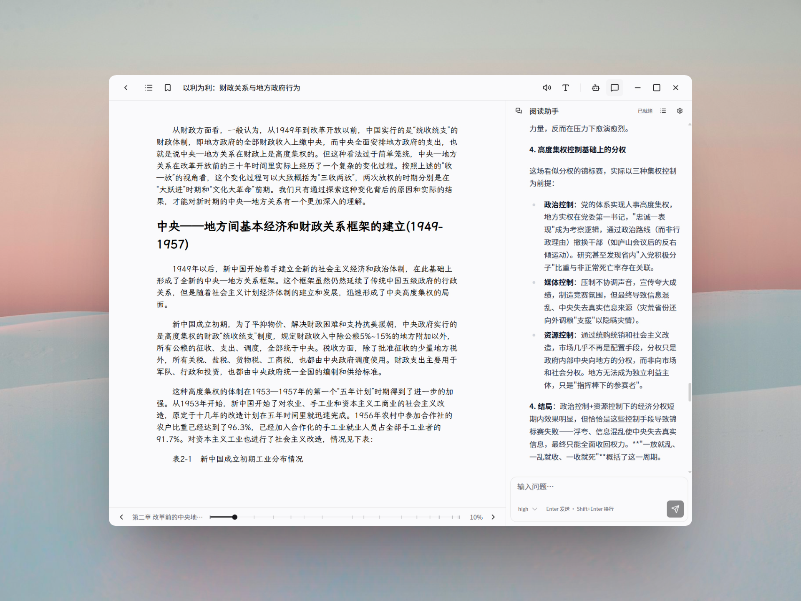

# Litera

[English](README.md) | **简体中文**

带阅读助手的 EPUB 阅读器，支持桌面与 Android。开启同步前，书籍始终留在本机；助手只请求你配置的 LLM 供应商。




## 功能

### 书库

- 通过文件选择、拖放，或系统「打开方式」导入 EPUB
- 按书名 / 作者搜索；按最近打开、书名、作者、导入时间、进度排序
- 网格 / 列表视图，顶部有「继续阅读」（最近打开的书）
- 导入后可改书名、作者、封面
- 替换文件时保留进度、排版和对话
- 关联 `.epub`（Windows 上若 Litera 是默认打开方式，资源管理器会显示封面缩略图）

### 阅读器

- 分页阅读 EPUB（滚轮、方向键，或点左右页边）
- 可折叠的嵌套目录；重开定位到上次看到的那段文字，而不只是章节
- 书签，以及多色高亮与笔记
- 脚注在原文处弹出，不跳到注释页
- 系统语音朗读当前页，支持跟读高亮和自动翻页
- 排版：字体、字号、行距、页宽、边距、字距、段距、首行缩进、对齐
- 「覆盖字体」「覆盖排版」两个独立开关，可压过 EPUB 内嵌字体和章节排版
- 浅色 / 深色 / 跟随系统；界面字体与字号不影响书页

### 同步（可选）

- 通过你自己的 S3 兼容存储桶（AWS S3、Cloudflare R2、Backblaze B2、MinIO 等）跨设备同步书库
- 阅读进度、书签、高亮与笔记、助手会话、排版与应用偏好自动一致；合并按条目进行（不会整库互相覆盖）
- 大书走分片上传；新设备先拉取清单，书文件按需下载
- 默认关闭。同步的数据以明文形式存储在你选择的存储桶中；LLM API 密钥与 S3 凭据永不离开设备
- Android 上的 **设置 → 本机 → 仅在 Wi-Fi 下传输书籍文件**（默认开启）让 EPUB 的上传和下载不走移动数据；进度、标注和会话照常同步。用移动数据打开尚未下载到手机的书时，会先显示大小并询问

### KOReader 同步（可选）

- 通过兼容 kosync 协议的进度服务器与 KOReader 交换阅读进度：KOReader 官方服务器（`https://sync.koreader.rocks`）、自建的 `koreader-sync-server`，或 [BookOrbit](https://github.com/bookorbit/bookorbit)（`https://<你的域名>/api/v1/koreader`，使用在 BookOrbit 里创建的 KOReader 凭据）
- 停止阅读后不久推送进度；打开书时如果别的设备有更新的位置，会先询问再跳转
- 只同步进度，不同步批注。书籍按 KOReader 的文件指纹匹配，所以各端需要是同一个 EPUB 文件
- 默认关闭，与 S3 同步互相独立。设置 → 同步 → KOReader 同步

### 阅读助手

- 两种布局：**阅读模式**（书为主）和 **Agent 模式**（对话为主）。每本书记住上次模式
- 选中一段再问，或直接打字
- 助手可按需读元数据、目录、章节窗口、书内检索，以及你的书签和高亮
- 每本书多个会话：新建、切换、重命名、编辑后重发
- 每会话可追加系统提示词（接在默认提示词后面，阅读工具说明会保留）
- 思考强度（off → max）；不支持思考的模型会自动降级
- 对话较长时用摘要压缩历史，而不是硬截断
- 内置供应商（Anthropic、OpenAI、DeepSeek、Google、OpenRouter、Groq、Mistral、xAI、Together、Fireworks），也可加 OpenAI 兼容的自定义端点（如 Ollama）

### 应用

- 简体中文与 English
- 关闭后再开，窗口位置和大小会恢复
- macOS、Windows、Linux 与 Android（手机使用触控布局：点按或滑动翻页，助手为底部面板；平板沿用桌面布局）

## 安装

从 [Releases](https://github.com/MaplumeX/Litera/releases) 下载最新构建：

| 平台 | 包 |
| --- | --- |
| Linux | `.AppImage`、`.deb` |
| macOS | `.dmg`（Apple Silicon） |
| Windows | NSIS 安装包 |
| Android 7.0+（64 位 ARM） | `.apk`：允许浏览器或文件管理器安装应用后打开即可。之后的 APK 可直接覆盖安装，书库保留 |

Android 上导入的书保存在应用私有目录，**卸载 Litera 会一并删除**（已同步的书可重新下载）。Litera 关闭了 Android 备份，API 密钥和 S3 凭据只留在手机上。

## 快速开始

1. 把 EPUB 导入书库（或从文件管理器打开；Android 上也可以用「打开方式」或分享给 Litera）。
2. 打开一本书开始读。进度、排版和标注会自动保存。
3. 要用助手：打开 **设置 → AI**，选供应商，填 API Key 和模型，再 **保存并应用**。
4. 在阅读页打开对话栏，或切到 Agent 模式。选中文字再问，或直接提问。

API Key 存在本机。书文件不会上传，只有你发出去的对话上下文会到所选供应商。

## 开发

需要 [Node.js](https://nodejs.org/) 22、较新的 [Rust](https://rustup.rs/) stable，以及对应系统的 [Tauri 2 依赖](https://v2.tauri.app/start/prerequisites/)。

Linux 额外依赖：

```bash
sudo apt-get install -y libwebkit2gtk-4.1-dev libappindicator3-dev librsvg2-dev patchelf xdg-utils \
  libfontconfig1-dev libfreetype6-dev
```

```bash
git clone --recurse-submodules https://github.com/MaplumeX/Litera.git
cd Litera
npm ci
npm run tauri dev
```

若克隆时没带子模块：

```bash
git submodule update --init --recursive
```

常用命令：

```bash
npm test                  # 前端测试（Vitest）
npx tsc --noEmit          # 类型检查
cargo test --manifest-path src-tauri/Cargo.toml
npm run tauri build       # 生产构建
```

EPUB 渲染来自 [foliate-js](https://github.com/johnfactotum/foliate-js)（`src/foliate-js`）。阅读助手是 WebView 内嵌的 [Pi](https://github.com/badlogic/pi-mono) 运行时，没有外部 sidecar。

### Android

需要 Android SDK 与 NDK（`ANDROID_HOME`、`NDK_HOME`）、JDK 17+，以及 Rust 目标 `aarch64-linux-android`（见 [Tauri Android 前置条件](https://v2.tauri.app/start/prerequisites/#android)）。

```bash
npm run tauri android dev                              # 在连接的手机或模拟器上运行
npm run tauri android build -- --apk --target aarch64  # 发布用 APK
```

APK 的版本名和版本号取自 `tauri.conf.json`，`npm run version:bump` 会一并更新。发布 CI 用 `ANDROID_KEYSTORE_BASE64`、`ANDROID_KEY_ALIAS`、`ANDROID_KEY_PASSWORD` 三个 secret 中的密钥库签名。请备份该密钥库：用别的密钥签名的 APK 无法覆盖安装旧版本。

## 更新日志

见 [CHANGELOG.md](CHANGELOG.md)。

## 许可

仓库目前没有顶层 LICENSE 文件。[foliate-js](https://github.com/johnfactotum/foliate-js) 为 MIT。
